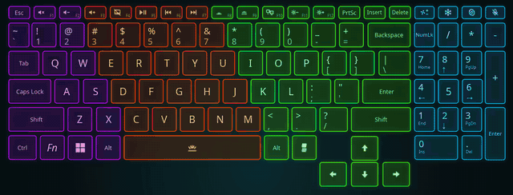
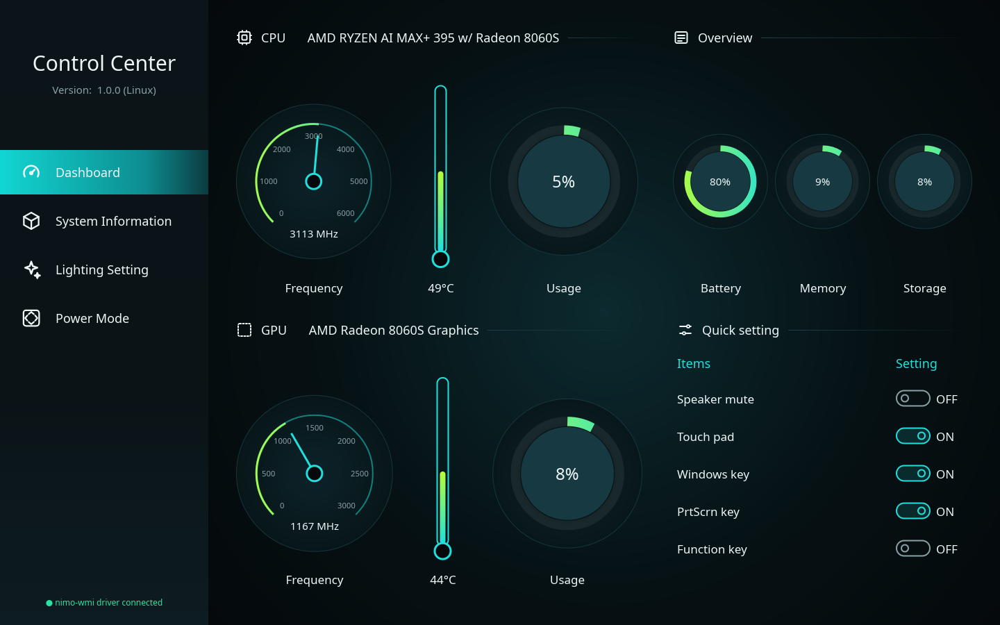
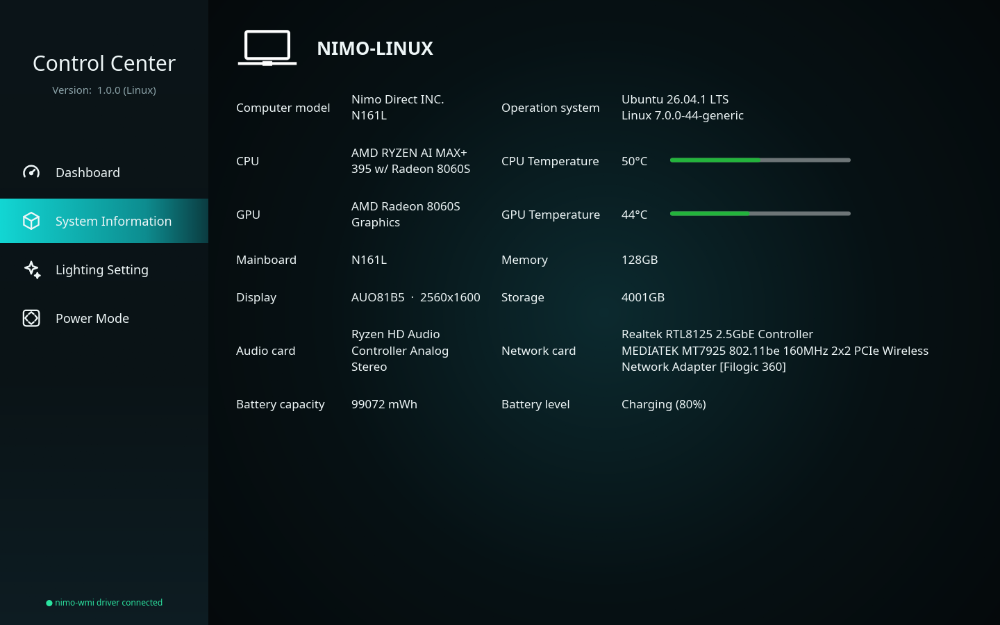
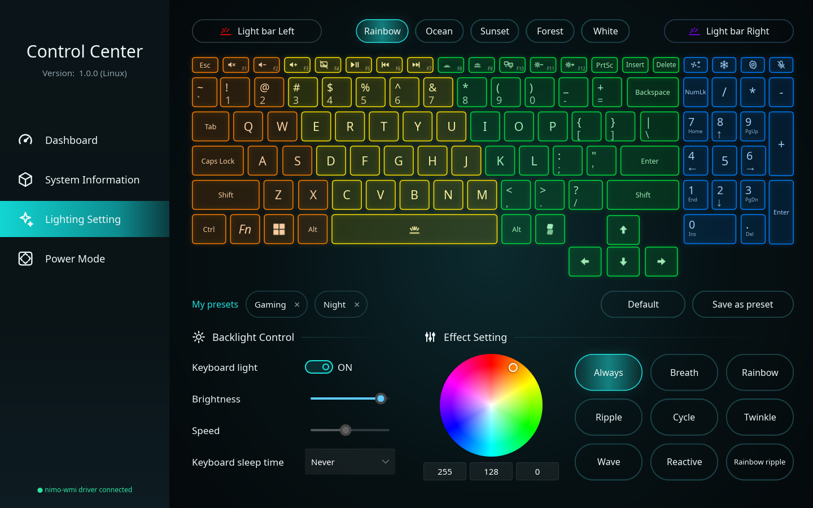
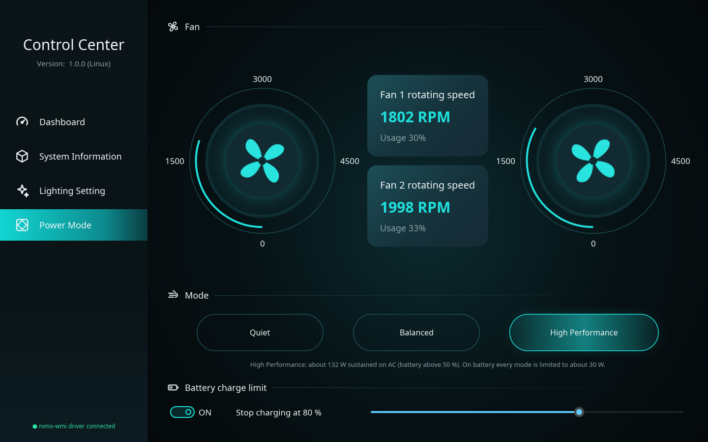

<div align="center">


# NIMO AXIS 395 on Linux

**A Linux driver and a Control Center app for the NIMO AXIS AI Max+ 395 (N161L) laptop.**
Keyboard RGB, side light bars, power modes, fans, key locks and battery charge limit, just like NIMO's Windows app, plus a few things it can't do.

[](LICENSE)
[](driver/LICENSE)




</div>

<br>

<table align="center"><tr><td align="center">

<h3>💬 Questions or comments?</h3>

Ask anything, share how it's going on your laptop, or let me know what's broken.

<a href="https://github.com/Andycodeman/nimo-axis-linux-fixes/discussions"></a>&nbsp;&nbsp;<a href="https://github.com/Andycodeman/nimo-axis-linux-fixes/issues/new/choose"></a>

</td></tr></table>

<br>

<a href="https://octoally.com"></a>

<h3>This repo is built and managed with OctoAlly Pro</h3>

<a href="https://octoally.com/download"></a>&nbsp;&nbsp;<a href="https://octoally.com"></a>

<br clear="left">

---

## Install

One line. It asks for your password when it needs it.

```sh
curl -fsSL https://raw.githubusercontent.com/Andycodeman/nimo-axis-linux-fixes/main/install.sh | sh
```

No `curl`? Stock Ubuntu doesn't ship it. Use `wget` instead:

```sh
wget -qO- https://raw.githubusercontent.com/Andycodeman/nimo-axis-linux-fixes/main/install.sh | sh
```

That's it. **NIMO Control Center** opens straight away, appears in your app menu, and starts in the tray every time you log in.

**Prefer a package?** On Ubuntu/Debian the one-liner installs the `nimo-control-center` .deb anyway. You can also download [`nimo-control-center_amd64.deb`](https://github.com/Andycodeman/nimo-axis-linux-fixes/releases/latest/download/nimo-control-center_amd64.deb) from the [latest release](https://github.com/Andycodeman/nimo-axis-linux-fixes/releases/latest) and open it in Discover / Software, or run `sudo apt install ./nimo-control-center_amd64.deb`.

> **Secure Boot on?** The installer asks you to pick a one-time password. Reboot, choose **Enroll MOK → Continue → Yes** on the blue screen, and type that password. This lets the kernel load the driver; it's the same step as for any DKMS driver (VirtualBox, NVIDIA, …).

### CachyOS / Arch

Use the same one-liner. On a pacman system it installs what the driver and the app need: `dkms`, `base-devel`, the headers for the kernel you're running (`linux-cachyos-headers`, `linux-cachyos-lts-headers`, `linux-headers`, …), `fontconfig` and `libxkbcommon`. On clang-built kernels such as CachyOS's it also installs `clang`, `llvm` and `lld`. It then installs the driver and the app the same way as everywhere else.

It's tested on CachyOS (Plasma) with `linux-cachyos` 7.3, `linux-cachyos-lts` 6.18 and Arch's own `linux` 7.3 kernel, with Secure Boot off. Plain Arch should work too, since Arch's kernel is one of the tested ones, but a pure Arch install hasn't been tried. Manjaro and EndeavourOS are untested; if you try one, [say how it went](https://github.com/Andycodeman/nimo-axis-linux-fixes/discussions).

- **Updated your kernel and haven't rebooted?** The installer stops and asks you to reboot first, because the headers have to match the kernel that's running. If pacman's headers are newer than your kernel, it asks you to run `sudo pacman -Syu`, reboot, and run it again.
- **Secure Boot on?** Not tested yet. DKMS signs the driver with its own key, `/var/lib/dkms/mok.pub`. If the driver doesn't load and you boot through shim, enroll that key with `sudo mokutil --import /var/lib/dkms/mok.pub` and reboot. With sbctl the kernel can't use that key, but CachyOS's kernels don't insist on signed modules, so the driver should load anyway. The installer prints these steps if the driver doesn't load.
- **Uninstall** with the uninstall one-liner below. It leaves `dkms` and the kernel headers installed.

### TUXEDO drivers installed?

TUXEDO's driver pack, `tuxedo-drivers` (`tuxedo-drivers-dkms` from the AUR, or TUXEDO's own package on Ubuntu), is made for TUXEDO laptops. One module in it, `ite_829x`, also takes over this NIMO's keyboard lighting (USB id `048d:8910`): each time it starts, and after every suspend, it turns the keyboard light off and makes every key white, wiping out the lighting NIMO Control Center sets.

When the installer finds it, it explains this and asks **Block ite_829x? [Y/n]** (Enter means yes). Blocking it is safe:

- Only `ite_829x` stops loading. The rest of `tuxedo-drivers` keeps working.
- Your keyboard types exactly as before. Nothing on this NIMO needs `ite_829x`; without it, the standard `hid-generic` driver handles that device.
- The whole change is one small file, `/etc/modprobe.d/nimo-block-ite_829x.conf` (`blacklist ite_829x` and `install ite_829x /bin/false`). If `ite_829x` is running, the installer also unloads it straight away.
- To undo it, run the uninstall one-liner or remove the package (`apt remove nimo-control-center`); both delete that file, but only if the installer wrote it. Or delete the file yourself and reboot.

Saying no changes nothing; your lighting may keep resetting, and the installer asks again next time you run it. If the installer can't ask (no terminal), it prints the same explanation and the two lines to put in that file, and changes nothing.

### Uninstall

Remove **NIMO Control Center** in Discover / Software, or:

```sh
sudo apt purge nimo-control-center
```

or the uninstall one-liner, which also cleans up installs made without the package:

```sh
curl -fsSL https://raw.githubusercontent.com/Andycodeman/nimo-axis-linux-fixes/main/uninstall.sh | sh
```

Every route removes the driver, the app and the permissions rule, and sets the battery charge limit back to 100 %. Your saved lighting and presets stay in `~/.config/nimo-control-center` unless you delete that folder (or pass `-s -- --purge` after `sh`).

---

## Screenshots

| Dashboard | System Information |
|---|---|
|  |  |
| **Lighting Setting** | **Power Mode** |
|  |  |

## What you get

### NIMO Control Center

The same four pages as NIMO's Windows Control Center, in the same look:

- **Dashboard:** CPU and GPU frequency dials, temperatures and usage; battery, memory and storage. Quick switches for speaker mute, touchpad, Windows key, PrtScrn key and Function key.
- **System Information:** model, CPU, GPU, mainboard, display panel, audio, network, OS, memory, storage and battery, with live temperatures.
- **Lighting Setting:**
  - The full keyboard, number pad included, glowing in its zone colours. Click a key to paint its zone, or a light-bar button to paint that bar.
  - All 9 firmware effects (Always, Breath, Rainbow, Wave, Cycle, Twinkle, Ripple, Reactive, Rainbow ripple), previewed live.
  - Colour wheel and R/G/B values, brightness, speed and keyboard sleep timer.
  - Built-in presets (Rainbow, Ocean, Sunset, Forest, White), plus **your own**: *Save as preset* stores the whole look.
- **Power Mode:** both fans with live RPM, and Quiet / Balanced / High Performance. Plus the **battery charge limit**: the firmware supports it, but the Windows app never showed it.
- **Tray icon:** power mode, keyboard light, effects and presets, with fan speeds on hover.

Changes apply as you make them and are re-applied when you log in. The keyboard itself forgets its lighting at every reboot.

### The nimo-wmi driver

A small kernel module (DKMS, so it rebuilds itself for new kernels) that exposes everything through standard Linux interfaces. The desktop's own settings use them too, not just the app:

| Feature | Where |
|---|---|
| Power modes | `platform_profile`, so **KDE's and GNOME's power menu** works |
| Fan speeds | hwmon `nimo` (`sensors`, system monitors) |
| Battery charge limit | `charge_control_end_threshold` on the battery |
| Keyboard brightness / colour | LED `nimo::kbd_backlight` |
| Zone colours, light bars, effects, speed, sleep timer, key switches | `/sys/bus/wmi/devices/8600ACCE-…[-N]/` (kernels 6.17+ add a `-N`) |

Details: [driver/README.md](driver/README.md).

## Is it safe? What does it change?

Everything is one normal package, `nimo-control-center`, so your package manager knows every file and removes them all. The one exception is the `ite_829x` block below, which the installer writes only if TUXEDO's drivers are installed and you say yes; uninstalling removes it too.

| Added | Why |
|---|---|
| `dkms` and your kernel's headers (pulled in by apt) | To build the driver, the same as any DKMS driver (NVIDIA, VirtualBox…). |
| The `nimo-wmi` driver source in `/usr/src`, built by DKMS | **Only loads on an N161L**: it checks the model and refuses anything else. |
| A `nimo` group (the computer's admins are added to it) and a udev rule | So the app can change settings without your password. |
| `/usr/bin/nimo-control-center`, its menu entry, icon and login autostart | The app. |
| Only with TUXEDO's drivers installed, if you agree: `/etc/modprobe.d/nimo-block-ite_829x.conf` | Stops TUXEDO's `ite_829x` resetting the keyboard lighting ([details](#tuxedo-drivers-installed)). Not part of the package. |

It doesn't touch your bootloader, firmware or BIOS settings, and it flashes nothing. One thing to know: the power-mode fix loads a corrected copy of one firmware routine into memory each time the driver starts. NIMO's original is left untouched, and nothing is written to the BIOS.

## Hardware status

| Part | ID | Linux status |
|---|---|---|
| Keyboard RGB (4 zones), side light bars, effects, sleep timer | EC, ACPI WMI | ✅ with this driver |
| Win / Fn / PrtSc key switches | EC, ACPI WMI | ✅ with this driver |
| Power modes (Quiet / Balanced / Performance) | EC + ACPI | ✅ with this driver |
| Fan speeds, battery charge limit | EC | ✅ with this driver |
| Wi-Fi 7: MediaTek MT7925 | PCI 14c3:7925 | ✅ Works (`mt7925e`) |
| Bluetooth: MediaTek MT7925 | USB 13d3:3604 | ✅ Works |
| Ethernet: Realtek 2.5GbE | PCI 10ec:8125 | ✅ Works (`r8169`) |
| Webcam + IR camera | USB 3277:00be | ✅ Works (UVC) |
| Keyboard (ITE) | USB 048d:8910 | ✅ Works |
| NPU: AMD XDNA | PCI 1022:17f0 | ✅ Firmware loads (`amdxdna`) |
| Audio codec: Realtek ALC233 | HDA `SUBSYS_2782A246` | 🟡 Detected; not fully tested |
| Internal mic array: AMD ACP 7.0 DMIC | PCI 1022:15e2 | 🟡 Works after lowering the input gain |
| Fingerprint: Microarray MAFP | USB 3274:8012 | ❌ Not in stock libfprint yet |

## How it was built

NIMO's Windows Control Center was installed under capture: Procmon, WMI tracing and USB capture of every setting ([windows/INSTRUCTIONS.md](windows/INSTRUCTIONS.md), [findings](notes/windows-capture-20261126.md)). The .NET app was decompiled, and its calls were matched against the laptop's ACPI tables.

Everything goes through the firmware's ACPI WMI interface, not USB. The full protocol is in **[notes/control-center-protocol.md](notes/control-center-protocol.md)**. Along the way it turned up:

- **A BIOS bug that blocks 17 firmware routines on Linux:** a field declared larger than its buffer. Windows ignores it; Linux refuses to run them. The driver works around it.
- **The keyboard sleep timer never worked on Windows** (a firmware bug); on Linux it does.
- The firmware has a **battery charge limit** that the Windows app never offered.

The protocol notes describe both bugs and the one-line BIOS fix for each.

## Building from source

```sh
git clone https://github.com/Andycodeman/nimo-axis-linux-fixes
cd nimo-axis-linux-fixes
app/build-release.sh               # needs Rust: https://rustup.rs (cargo build --release, minus build paths)
./install.sh                        # uses your build
```

Releases are built by GitHub Actions. The app is built on Ubuntu 24.04, so it runs there and on anything newer; the driver is tested on Linux 7.0 (Ubuntu 26.04, what the N161L ships with) and on CachyOS's kernels, and needs a recent kernel. On CachyOS, a manual `make -C driver` needs `LLVM=1` because its kernels are built with clang; DKMS adds that by itself. To make a release, bump the version in `app/Cargo.toml`, add a `CHANGELOG.md` entry, and push a tag such as `vX.Y.Z`. `packaging/build-deb.sh` builds the .deb locally.

## Questions and feedback

- **Questions, comments, or how it's going on your laptop:** [Discussions](https://github.com/Andycodeman/nimo-axis-linux-fixes/discussions)
- **Something broken:** [open an issue](https://github.com/Andycodeman/nimo-axis-linux-fixes/issues/new/choose). The bug form asks for your distro, kernel and the driver log.

## Credits and disclaimer

This is an independent community project, **not affiliated with or endorsed by NIMO or Emdoor**. "NIMO" and "AXIS" are their trademarks and are used only to say which laptop this is for. The keycap icons, the app's icon and all code are original to this project. The keyboard layout's key positions come from Control Center's key map, so the drawing matches the real keyboard.

It works on the author's N161L. Use it at your own risk; it comes with no warranty (see the licences).

- App: [GPL-3.0-or-later](LICENSE). Built with [Slint](https://slint.dev) and [ksni](https://crates.io/crates/ksni).
- Driver: [GPL-2.0-or-later](driver/LICENSE), like the Linux kernel.

Same approach as [samsung-galaxy-book-linux-fixes](https://github.com/Andycodeman/samsung-galaxy-book-linux-fixes).
